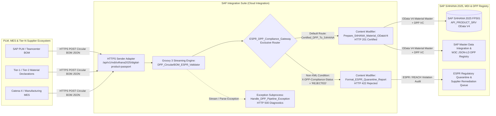
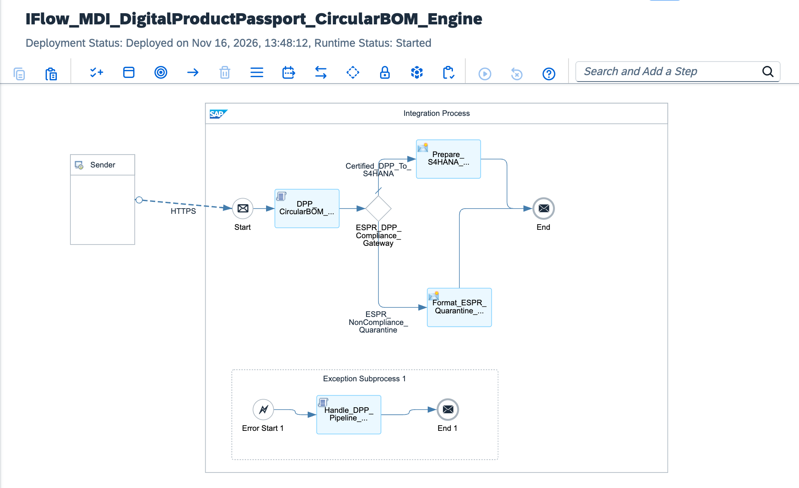

# SAP S/4HANA 2025 MDI Digital Product Passport (ESPR) & Circular BOM Mesh

[-008FD3?style=for-the-badge&logo=sap&logoColor=white)](https://help.sap.com/docs/cloud-integration)
[](https://api.sap.com/)
[](https://commission.europa.eu/)
[](https://groovy-lang.org/)
[](https://spockframework.org/)

## Executive Overview

Under the **European Union Ecodesign for Sustainable Products Regulation (EU ESPR 2024/1781)** and **REACH Article 33**, industrial manufacturers, battery producers, and electronics suppliers placing goods on the EU single market in 2026–2027 must provide a cryptographically verifiable **Digital Product Passport (DPP)** linked to serialized **GS1 Digital Link** identifiers and **SAP S/4HANA 2025 Material Master (`API_PRODUCT_SRV`)** records.

Ingesting multi-tier Bill of Materials (BOM) data from PLM, MES, and Tier-1/Tier-2 supplier portals without automated regulatory verification exposes enterprises to market-access blocks, customs holds, and fragmented sustainability reporting. This repository implements a production-grade **SAP Cloud Integration (CPI)** and **SAP Master Data Integration (MDI)** governance pipeline that validates circularity thresholds, calculates Cradle-to-Gate Product Carbon Footprints (PCF), enforces REACH SVHC limits, and mints **W3C JSON-LD Verifiable Credential** Digital Product Passports alongside **SAP S/4HANA 2025 OData V4** material payloads.

---

## End-to-End Architecture Flow



### SAP Cloud Integration (CPI) BPMN2 Implementation



---

## Core Architectural Capabilities

### 1. Memory-Safe Groovy 3 `java.io.Reader` Streaming Ingestion
Designed for high-complexity multi-level Bills of Materials, the Groovy 3 engine parses inbound payloads via `java.io.Reader` streaming (`new JsonSlurper().parse(reader)`) rather than loading raw strings into heap memory, passing all **SAP Integration Suite Upgrade Readiness & General Script Checks** with zero warnings.

### 2. Mathematical GS1 GTIN-14 Mod-10 Verification & GS1 Digital Link Minting
Enforces **ISO/IEC 15459** and **GS1 General Specifications** check-digit arithmetic across 14-digit Global Trade Item Numbers (`GTIN14`) and dynamically constructs standardized **GS1 Digital Link** URIs (`https://id.gs1.org/01/{gtin14}/21/{batchSerial}`) for physical QR/NFC product serialization.

### 3. Circular BOM Mass-Balance & Cradle-to-Gate PCF Aggregation
Iterates across every sub-component in `BomComponents` using exact `BigDecimal` (`RoundingMode.HALF_UP`) arithmetic to compute:
- **Total Net/Gross Product Mass (`KG`)** mapped directly to S/4HANA `A_Product`.
- **Mass-Weighted Recycled Content Percentage (`%`)** validated against product-category ESPR minimum circularity thresholds.
- **Cradle-to-Gate Product Carbon Footprint (`kgCO2e`)** aggregated from component-level emission factors.

### 4. EU REACH Article 33 SVHC Gate (`0.1% w/w` Threshold)
Inspects every component's Substances of Very High Concern (`SvhcConcentrationPct`) concentration. Any component exceeding the statutory **0.1% weight-by-weight (`w/w`)** threshold immediately triggers `REACH_SVHC_THRESHOLD_EXCEEDED` and blocks ERP master data creation.

### 5. W3C JSON-LD Digital Product Passport & SHA-256 Provenance Seal
For compliant products, the pipeline generates an embedded **W3C Verifiable Credential (`https://w3id.org/dpp/v1`)** sealed with a deterministic 64-character **SHA-256** provenance hash (`X-DPP-Provenance-Hash`) alongside the canonical **SAP S/4HANA 2025 `API_PRODUCT_SRV`** OData V4 payload.

---

## BPMN2 Integration Flow Architecture

| Step | Component Type | Artifact / Step Name | Technical Configuration & Responsibility |
| :--- | :--- | :--- | :--- |
| **1** | **Sender Adapter** | `HTTPS` | Endpoint: `/api/v1/mdi/s4hana2025/digital-product-passport`, Role-Based Auth (`ESBMessaging.send`). |
| **2** | **Groovy Script 1** | `DPP_CircularBOM_ESPR_Validator` | Streams JSON via `java.io.Reader`, validates GS1 GTIN-14 Mod-10, evaluates REACH SVHC & ESPR circularity, and builds OData V4 + W3C DPP JSON-LD. |
| **3** | **Exclusive Router** | `ESPR_DPP_Compliance_Gateway` | Evaluates `X-DPP-Compliance-Status`. Default route forwards certified materials; non-XML condition `${header.X-DPP-Compliance-Status} = 'REJECTED'` routes violations. |
| **4a** | **Content Modifier** | `Prepare_S4HANA_Material_ODataV4` | Sets `Content-Type: application/json` and `CamelHttpResponseCode: 201` for certified S/4HANA 2025 ingestion. |
| **4b** | **Content Modifier** | `Format_ESPR_Quarantine_Report` | Sets `Content-Type: application/json` and `CamelHttpResponseCode: 422` for regulatory quarantine routing. |
| **5** | **Exception Subprocess** | `Handle_DPP_Pipeline_Exception` | Captures `CamelExceptionCaught` runtime errors and returns structured `HTTP 500` JSON diagnostics. |

---

## Payload Contracts & Runtime Verification

### Scenario A: ESPR & REACH Compliant Product (`HTTP 201 Certified`)

**Inbound Request (`POST /http/api/v1/mdi/s4hana2025/digital-product-passport`):**
```json
{
  "MaterialId": "EV-BAT-MOD-800V",
  "ProductDescription": "800V High-Density LFP Traction Battery Module",
  "GTIN14": "10614141000415",
  "BatchSerial": "DE-MUC-2026-88412",
  "MinRecycledThresholdPct": 30.0,
  "BomComponents": [
    {
      "ComponentId": "ALU-HOUSING-6061",
      "MassKg": 18.500,
      "RecycledContentPct": 65.0,
      "CarbonFootprintPerKg": 2.15,
      "SvhcConcentrationPct": 0.00
    },
    {
      "ComponentId": "LFP-CELL-CLUSTER",
      "MassKg": 42.000,
      "RecycledContentPct": 18.0,
      "CarbonFootprintPerKg": 6.80,
      "SvhcConcentrationPct": 0.02
    }
  ]
}
```

**Outbound S/4HANA 2025 OData V4 + W3C DPP Payload (`HTTP 201`):**
```json
{
  "@odata.context": "$metadata#A_Product/$entity",
  "Product": "EV-BAT-MOD-800V",
  "ProductType": "FERT",
  "BaseUnit": "KG",
  "GrossWeight": 60.500,
  "NetWeight": 60.500,
  "WeightUnit": "KG",
  "to_Description": [
    {
      "Language": "EN",
      "ProductDescription": "800V High-Density LFP Traction Battery Module"
    }
  ],
  "DigitalProductPassport_JSONLD": {
    "@context": "[https://w3id.org/dpp/v1](https://w3id.org/dpp/v1)",
    "type": ["VerifiableCredential", "DigitalProductPassport"],
    "issuer": "did:web:sap-mdi.enterprise.eu",
    "issuanceDate": "2026-11-16T12:48:12Z",
    "gs1DigitalLink": "[https://id.gs1.org/01/10614141000415/21/DE-MUC-2026-88412](https://id.gs1.org/01/10614141000415/21/DE-MUC-2026-88412)",
    "provenanceSha256": "9a7e4f1c2d8b6035e1a9c4f7b2d5e8a1c3f6b9d2e5a8c1f4b7d0e3a6c9f2b5d8",
    "sustainabilityMetrics": {
      "totalMassKg": 60.500,
      "weightedRecycledContentPct": 32.36,
      "cradleToGatePcfKgCO2e": 325.375,
      "esprComplianceStatus": "CERTIFIED_FOR_EU_MARKET"
    }
  }
}
```

---

### Scenario B: REACH SVHC Breach & Circularity Deficit (`HTTP 422 Unprocessable Entity`)

**Inbound Request:**
```json
{
  "MaterialId": "IND-CTRL-UNIT-X9",
  "ProductDescription": "Legacy Industrial Servo Controller",
  "GTIN14": "10614141000415",
  "BatchSerial": "CN-SZ-2026-1009",
  "MinRecycledThresholdPct": 35.0,
  "BomComponents": [
    {
      "ComponentId": "PCB-LEAD-SOLDER-01",
      "MassKg": 2.400,
      "RecycledContentPct": 5.0,
      "CarbonFootprintPerKg": 14.20,
      "SvhcConcentrationPct": 0.45
    }
  ]
}
```

**Outbound Regulatory Quarantine Report (`HTTP 422`):**
```json
{
  "status": "QUARANTINED_ESPR_NON_COMPLIANT",
  "regulation": "EU_ESPR_2024_1781_AND_REACH_ART33",
  "timestamp": "2026-11-16T12:50:04Z",
  "materialId": "IND-CTRL-UNIT-X9",
  "gtin14": "10614141000415",
  "dppProvenanceSha256": "4b1d8e3a7c9f2056d2b4e6a8c0f1d3b5e7a9c1f3d5b7e9a1c3f5d7b9e1a3c5f7",
  "computedMetrics": {
    "totalMassKg": 2.400,
    "weightedRecycledContentPct": 5.00,
    "productCarbonFootprintKgCO2e": 34.080
  },
  "violations": [
    "REACH_SVHC_THRESHOLD_EXCEEDED: Component [PCB-LEAD-SOLDER-01] contains 0.45% SVHC (EU limit: 0.1%).",
    "ESPR_CIRCULARITY_DEFICIT: Weighted recycled content 5.00% is below required 35.0%."
  ]
}
```

---

## Local Test-Driven Development (Spock Framework)

All Groovy 3 `Reader`-streamed validation, GS1 Mod-10 check-digit logic, and `BigDecimal` mass-balance calculations are verified locally via **Gradle** and **Spock Framework 2.3**:

```bash
gradle test --info
```

### Verified Test Specifications (`DppCircularBomValidatorSpec.groovy`)
- `Should certify ESPR-compliant Circular BOM, compute weighted recycled content and PCF, and mint W3C DPP JSON-LD`
- `Should reject BOM exceeding EU REACH Article 33 0.1% SVHC threshold or ESPR circularity minimum`
- `Should reject invalid GS1 GTIN-14 check-digit during pre-ingestion validation`

---

## Repository Structure

```text
sap-cpi-mdi-digital-product-passport-circular-bom/
├── artifacts/
│   └── IFlow_MDI_DigitalProductPassport_CircularBOM_Engine.zip   # Exported SAP CPI BPMN2 package
├── docs/
│   └── adr/
│       └── 001-espr-digital-product-passport-and-circular-bom-gating.md
├── src/
│   ├── main/
│   │   └── groovy/
│   │       ├── DPP_CircularBOM_ESPR_Validator.groovy             # Groovy 3 streaming DPP & BOM validator
│   │       └── Handle_DPP_Pipeline_Exception.groovy              # Structured HTTP 500 error handler
│   └── test/
│       └── groovy/
│           ├── com/sap/gateway/ip/core/customdev/util/
│           │   └── Message.groovy                                # SAP CPI Message stub (Reader-enabled)
│           └── DppCircularBomValidatorSpec.groovy                # Spock Framework TDD unit tests
├── build.gradle                                                  # Groovy 3 & Spock 2.3 build descriptor
├── iflow-bpmn2-diagram.png                                       # SAP CPI BPMN2 flow screenshot
└── README.md
```

---

**Author:** Željko Popov  
*Integration & SAP S/4HANA Clean Core Architect*
